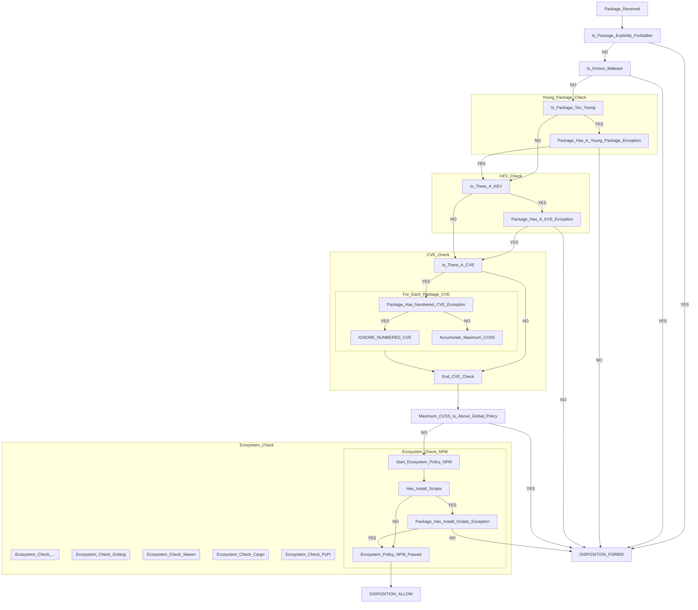

# Policy shape and how a package is judged

- **Status:** Decided. Supersedes plan §5 and §5.5.
- **Plan reference:** §5 and §5.5, both of which now describe something else
- **Related:** [package-override-tier](package-override-tier.md),
  [policy-engine-hand-rolled](policy-engine-hand-rolled.md)

The flow chart below is the decision. Everything after it follows from it.

## Decision flow chart for what packages are delivered or rejected



### NOTES

The following settings are configurable in policy:

1. The CVSS threshold for an Allow disposition. At or below is allowed, above is forbidden. Global setting.
2. The age threshold for the Is_Package_Too_Young check (typically 7 days). Global setting.
3. Packages that are allowed to be younger than the exception. Package-specific setting.
4. Packages that are allowed even with KEVs.
5. Packages that are allowed even with specific numbered CVEs.
6. Packages that are allowed to have install scripts (ecosystem-dependent, package-specific setting).
7. Packages that are explicitly forbidden.

## The policy file

```yaml
version: 1

# Thresholds. One value each for the deployment.
cooldown_days: 7           # note 2
max_cvss: 6.9              # note 1

# Whether these checks run. One value each for the deployment.
install_scripts: block
kev: block

# Explicitly forbidden. Exact versions, permanent, absolute. Note 7.
denials:
  - purl: "pkg:npm/evil@1.0.0"
    reason: "malware"

# Exceptions, notes 3 to 6. Per package. May only loosen.
packages:
  - match: { ecosystem: npm, name: "@mycompany/*" }
    set: { cooldown_days: 0 }
    reason: "published by our CI"
    permanent: true

  - match: { ecosystem: npm, purl: "pkg:npm/legacy-thing@2.1.0" }
    set: { kev: allow, cve_ids: ["CVE-2024-1234"] }
    reason: "mitigated by network policy"
    expires: "2026-11-30"
```

Every setting is global. Every exception is per package. Nothing is per ecosystem.

| | scope | may be excepted |
|---|---|---|
| known malware | not configurable | no |
| `denials` | per package | no |
| `cooldown_days` | global | yes, note 3 |
| `kev` | global | yes, note 4 |
| `max_cvss` | global | yes, per CVE id, note 5 |
| `install_scripts` | global | yes, note 6 |

## What is not configurable, and why

**Known malware always blocks.** No setting, no exception. The chart gives it no exception
branch and the notes do not list it, which makes it behaviour rather than policy.

**Which ecosystems run which check.** `install_scripts` is a global setting asked of every
ecosystem, and Go has no install step to ask about. That is a property of Go, not
something an operator sets. Such a rule reports **not-applicable**, never a violation, per
§5.5's rule of the same name, which survives intact.

**Whether a check may be excepted.** Fixed by the chart. There is no floor tier: an
organisation that does not want KEV exceptions writes none.

## Actions

`allow < quarantine < block`. Three values, and each has a producer:

| | meaning | produced by |
|---|---|---|
| `allow` | delivered | everything that passes |
| `quarantine` | refused now, allowed later | a package younger than `cooldown_days` |
| `block` | refused | denials, known malware, KEV, a CVE over `max_cvss`, install scripts |

The chart's two dispositions are the delivery projection of these: FORBID is
`{quarantine, block}`, ALLOW is `allow`. `explain` has to report which of the three, or an
operator cannot tell a refusal that will lift by itself from one that will not.

`quarantine` lapses without anyone doing anything: a young package ages. That is what
separates it from `block`, and why collapsing the two into one disposition would lose the
thing an operator most needs to know.

**It is a packument filter, not an artifact refusal.** A version that is too young is
removed from the document the client resolves against, so the client picks an older one by
itself rather than failing. That is
[quarantine-filter-metadata](quarantine-filter-metadata.md), and Stage 1 already built
the mechanism as `npm::filter_unservable_versions`. `block` is the other shape: the
artifact is refused when asked for.

`warn` is not in the lattice. Nothing delivers-with-a-concern: provenance, the one
candidate, is a recorded attribute rather than an action.

## Provenance is recorded, not required

`dist.attestations` and the rest are kept on the package record and shown in `explain`.
Nothing is refused for lacking them, and there is no `provenance_required` setting.

Measured on the 138 packages of a real `npm install express eslint`, latest version of
each, straight from registry.npmjs.org:

| | of 138 |
|---|---|
| has an install script | 0 |
| has no provenance | 112 (81%) |

Of the 30 most-downloaded packages, 15 publish provenance, and that is the most
favourable sample available.

Every other check fires on a minority, which is why per-package exceptions work for them.
Requiring provenance would forbid the majority, and the exception list would become the
dependency list: 112 entries for one small install, each with a reason and an expiry
inside the 90-day ceiling. That is a lockfile maintained by hand.

It is also the one check that cannot be asked of every ecosystem: npm has
`dist.attestations`, PyPI has PEP 740 at low coverage, cargo has nothing, Maven has GPG
signatures, which are identity rather than build provenance, and Go has a checksum
database, which is tamper-evidence. A global requirement would forbid 100% of three
ecosystems.

Stage 1 already records all of it: `record::Provenance` carries `attestation_url`,
`predicate_type`, `registry_signatures` and `trusted_publisher`.

## What this changes in the plan

§5 and §5.5 describe a different system. Both need rewriting:

| plan says | now |
|---|---|
| `ecosystems:` overrides global rules per ecosystem | no per-ecosystem settings exist |
| `floor:`, mandatory per enabled ecosystem, startup failure if missing | no floor tier |
| adding an adapter breaks configs until a floor is declared | adding an adapter breaks nothing |
| `packages` handles loosening **and** tightening | loosening only; tightening is a load error |
| `allow < warn < quarantine < block` | `allow < quarantine < block` |
| `provenance_required` is a rule | an attribute of the record |
| `loosens_global` + `reason` + `expires` acknowledges an ecosystem loosening | nothing to acknowledge |
| `max_cvss` in the monotonicity table only | a real setting, note 1 |
| KEV | absent from the plan entirely |

Two things §5.5 got right and keep earning their place: **not-applicable is never a
violation**, and **specificity is strict subset containment, not a score**.

## What this means for the code

| | |
|---|---|
| `selector.rs` | kept whole. The exception lists are selectors and still have to be orderable. |
| `packages.rs` | kept. The exception tier is now the entire configurable surface. |
| `strictness.rs` | kept, minus `Warn`. `packages` may only loosen, so tightening has to be detected to refuse it. |
| `merge::applies` | kept. Not-applicable is why. |
| the rest of `merge.rs` | deleted. Nothing to merge. |
| `floor`, `check_floors`, `check_enabled` | deleted. |
| `ecosystems`, `EcosystemRules` | deleted. |
| `ScriptDetail`, `ScriptRule`'s hand-written `Deserialize` | deleted. |
| `Action::Warn` | deleted. |
| `npm::filter_unservable_versions` | reused. `quarantine` is a packument filter, which is what it already does. |

`ScriptRule` is polymorphic only because its detailed form carried the acknowledgment, and
nothing acknowledges now. A `packages` entry carries its own `reason` and `expires` at
entry level, so `set: { install_scripts: allow }` needs no inner table, and `ScriptRule`
becomes an `Action`.

The measurement behind that deserialiser stands on its own and is worth keeping: an
`untagged` enum refuses a typo'd key but names neither the key nor the right line. The
next polymorphic field will need the hand-written form.

## Still open

- **Inferred, not stated:** that `install_scripts` and `kev` take `block` or `allow` and
  nothing else. `quarantine` is meaningless for both, since waiting does not change
  whether a package has an install script or a KEV.
- **A `packages` entry that changes nothing** is currently loaded in silence. Refused,
  warned about, or ignored.
- **The order reports the reason that will lapse, not the worst one.** A package both too
  young and carrying a KEV is refused for being too young. Granting the age exception
  leaves it refused for a reason the operator only then sees. Putting the absolute checks
  first would report the more serious finding at no cost to the outcome.
