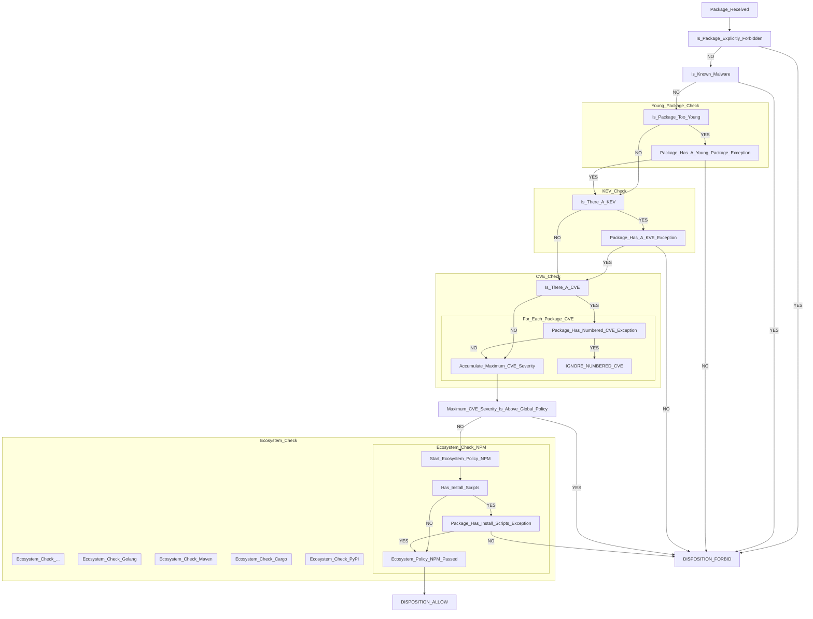

# How the policy tiers resolve

- **Status:** Partly decided. The floor question is dissolved; the tier contents are open.
  Implementation stopped.
- **Plan reference:** §5 (superseded shape), §5.5 (current shape)
- **Related:** [package-override-tier](package-override-tier.md),
  [policy-engine-hand-rolled](policy-engine-hand-rolled.md)

This records the tier structure exactly as the plan describes it, and isolates the one
place where two sentences in §5.5 give different answers.

## Decision flow chart for what packages are delivered or rejected



### NOTES

The following settings are configurable in policy:

1. The CVE threshold for an Allow disposition. At or below is allowed, above is forbidden. Global setting.
2. The age threshold for the Is_Package_Too_New check (typically 7 days). Global setting.
3. Packages that are allowed to be younger than the exception. Package-specific setting.
4. Packages that are allowed even with KEVs.
5. Packages that are allowed even with specific numbered CVEs.
6. Packages that are allowed to have install scripts (ecosystem-dependent, package-specific setting).
7. Packages that are explicitly forbidden.

## `provenance_required`: measured before deciding

The chart gives `install_scripts` the shape every other check has: a condition, a
per-package exception, and FORBID if there is no exception. The open question is whether
`provenance_required` takes the same shape.

Measured against the 138 packages of a real `npm install express eslint`, latest version
of each, straight from registry.npmjs.org:

| check | how many of the 138 it would forbid |
|---|---|
| has an install script | **0** |
| has no provenance | **112** (81%) |

The install-script probe is not broken; run against `esbuild`, `bcrypt`, `node-sass` and
`core-js` it finds all four. That tree simply has none.

Of the 30 most-downloaded packages, 15 publish provenance. That is the most favourable
sample available and it is still half, because popularity is exactly what correlates with
having adopted it.

### What that means

**Every other check in the chart fires on a minority.** Malware is rare, a package being
younger than a week is rare, a KEV is rare, a CVE above the threshold is uncommon, an
install script was absent altogether here. The per-package exception mechanism works
because exceptions are the exception.

`provenance_required: true` inverts that. It forbids the majority, so the exception list
becomes the dependency list: 112 entries for one small install, each needing a `reason`
and an `expires` under the `packages` tier's own rules, each re-reviewed inside the 90-day
ceiling. That is not an exception list, it is a lockfile maintained by hand.

**It is also the one check that cannot be asked of every ecosystem.** Malware, age, KEV
and CVE all read ecosystem-agnostic intel, which is why they sit on the global spine.
Provenance does not exist to ask about in the same way:

| ecosystem | mechanism |
|---|---|
| npm | `dist.attestations`, sigstore-backed |
| PyPI | PEP 740 attestations, recent, low coverage |
| cargo | none |
| Maven | GPG signatures: identity, not build provenance |
| Go | checksum database: tamper-evidence, not provenance |

A global `provenance_required: true` would forbid **100%** of cargo, Maven and Go. §5.5
already has the answer to that shape, and it is not "forbid": *"Floor rules that do not
apply to an ecosystem report not-applicable, never a violation."*

So provenance belongs in the per-ecosystem subgraph next to `install_scripts`, not on the
global spine. That much the evidence settles.

### Decided: a recorded signal, not a gate

Provenance present is a positive fact, kept and shown in `explain`. Provenance absent is
the ordinary state of the registry and not a finding. Nothing is forbidden for lacking it.

**Most of this already exists.** Stage 1 records it: `record::Provenance` carries
`attestation_url`, `predicate_type`, `registry_signatures` and `trusted_publisher`, read
out of both packument shapes. The work is not to build a signal, it is to stop treating it
as a rule.

So `provenance_required` **leaves the policy schema**. It is not a rule with an action,
because it never produces one; it is an attribute of a package, and the record is where
attributes live. That removes it from `Defaults`, `EcosystemRules`, `FloorRules` and
`SetBlock`.

### Also noticed

The chart has `Package_Has_Install_Scripts_Exception` but the notes list no setting for
it. Notes 1 to 5 cover the CVE threshold, the age threshold, and three exception lists;
there is no note 6 for install-script exceptions. Whatever `provenance_required` turns out
to be, `install_scripts` needs the same entry.

## What the flow chart implies for the configuration

Read against the schema in `src/policy.rs` and §5.5, the flow says seven things.

### 1. Two dispositions, four actions. Both survive.

The flow ends at FORBID or ALLOW; the lattice is `allow < warn < quarantine < block`.
They are not in conflict, because the flow is the **delivery** projection of the lattice:

```
  block       ┐
              ├─ DISPOSITION_FORBID     the bytes do not reach the client
  quarantine  ┘
  warn        ┐
              ├─ DISPOSITION_ALLOW      the bytes reach the client
  allow       ┘
```

`Is_Package_Too_New -> FORBID` is the proof that both halves are needed: that refusal
lapses as the package ages, which is `quarantine`, not `block`. And `warn` delivers, so
it cannot appear in a chart about what is delivered. `explain` has to report which of the
four, not which of the two, or an operator cannot tell a refusal that will lift by itself
from one that will not.

### 2. `max_cvss` is declared in the plan and missing from the schema

The plan's monotonicity table already gives it a direction (§5, "lower is stricter"), and
the intel section already says a matching stream can change a verdict through it. The
`Policy` struct has no such field. Note 1 requires it.

It slots in without new machinery: `Direction::LowerIsStricter` already exists and is
proved to be the mirror of the other direction.

Open shape question: the flow branches on **bands** (CRITICAL / HIGH / MEDIUM / LOW) while
`max_cvss` is a **number**. A band is coarser and is not stable across CVSS versions, where
the same score falls in different bands under v2 and v3. A number said what it meant.

### 3. KEV is new, and has the shape of a floor rule

It appears nowhere in the plan. In the flow it forbids with no exception path, which is
the same shape as `known_malware`: absolute, unexemptable. `known_malware: block` is
currently the only rule pinned into every floor.

### 4. The flow does not use two rules the schema has

`install_scripts` and `provenance_required` are in the schema, in the shipped example, in
the merge, and `install_scripts` has a hand-written deserialiser written specifically to
keep its diagnosis readable. Neither appears in the flow.

### 5. The exception shape the schema has is the more expressive one, and it already matches

`Package_Has_A_Young_Package_Exception` is a per-check boolean. The schema's
`packages[].set { cooldown: { days: 0 } }` is a per-rule value, which subsumes it:
`days: 0` is "any age", `days: 2` is "at least two days". Nothing needs to change.

The flow also settles something the schema had left implicit and got right: an exception
is **per check, not a pass**. A young package with an exception continues to the KEV
check rather than skipping to ALLOW, which is exactly what a per-rule `set` block does.

### 6. The order decides which reason is reported, not just the outcome

`Is_Package_Too_New` is evaluated before `Is_There_A_KEV`, and both forbid. So a package
that is too new *and* has a KEV, with no exception, is refused for being too new. The
reason an operator is given is the one that will lapse on its own, not the one that will
not. Granting the age exception would then leave the package still refused, for a reason
they only now see.

Putting the absolute checks first (malware, KEV) and the temporal ones after would report
the more serious finding, at no cost to the outcome.

### 7. "Global setting" may or may not mean "not per ecosystem"

Notes 1 and 2 call the CVE and age thresholds global, against note 3's package-specific
exception. The schema has a tier between them: `ecosystems`, which today can override
`cooldown`. If "global" is meant in contrast to "package-specific", the ecosystem tier is
untouched. If it is meant literally, the ecosystem tier loses those rules.

## What this does, and does not, settle about the floor

**Settles:** the floor holds the checks with no exception path. The flow gives
`known_malware` and KEV no branch out, and gives the age and CVE checks one. That is the
floor's membership, drawn.

**Does not settle:** the flow contains no case where a package-specific setting is
*stricter* than a global one. Every exception in it loosens. The clamp and short-circuit
readings differ only on tightening, so the chart passes straight over the disagreement.

**But it raises the question behind the question.** If the `packages` tier only ever
loosens, the floor's two readings never diverge and the decision is moot for v1. §5.5 says
otherwise, naming "raising cooldown on a package you distrust" as a case the tier handles.
Whether that case is real is now the thing to answer, and it is a smaller question than
the one it replaces.

## Answers, and what they cost

### The `packages` tier only loosens. **Decided.**

This dissolves the question this file was opened for. Clamp and short-circuit differ only
when a lower tier is *stricter* than the floor, and a tier that cannot tighten never
produces that case. Both readings of §5.5 now agree on every input.

It also contradicts §5.5, which names "raising cooldown on a package you distrust" as a
case the tier handles. The plan needs that sentence removed, and the tier's own paragraph
reads differently without it: "so `packages` is the honest name" was an argument for
renaming `exceptions`, and the rename loses its reason.

Three consequences for code already written:

- A `packages` entry that tightens becomes a **load-time error**. `packages::check`
  currently permits one and merely asks nothing of it.
- `Strictness::Stricter` at this tier goes from "fine, needs no justification" to
  "refused", which inverts one branch of the existing check.
- An entry that neither loosens nor tightens is a dead entry. Currently it loads silently.
  Whether that is refused, warned about, or left alone is a smaller open question.

### The age and CVE thresholds are one value for the deployment. **Decided.**

Not per ecosystem. This takes `cooldown` out of the `ecosystems` tier, and `max_cvss`
never goes in.

**This may leave the `ecosystems` tier with nothing in it.** It currently carries three
rules: `cooldown`, which is now global; and `install_scripts` and `provenance_required`,
whose status is pending a chart that does not cover them yet.

If both of those also turn out to be global or absent, the tier is empty, and the
machinery built to serve it has no consumer: the global→ecosystem merge, the loosening
report, the `loosens_global` acknowledgment with its expiry, and the ecosystem-tier
warnings emitted at config load. The floor stays per-ecosystem regardless, so
per-ecosystem configuration does not vanish entirely.

Not acted on yet. The answer depends on the two rules the chart has still to cover.

### KEV is a rule, blocking by default, exemptable. **Decided.**

Not hard-wired like `known_malware`. It is written in the policy file, it blocks unless
something says otherwise, an operator may pin it into their floor to make it unbypassable
for their org, and a package may be exempted with a reason and an expiry.

That makes it the first rule whose *default* is `block` without being *pinned*.
`known_malware` is required in every floor and cannot be weakened; `kev` is neither.
Three different things now live in the floor and they need keeping apart:

| | in every floor | weakenable | exemptable per package |
|---|---|---|---|
| `known_malware` | required by the schema | no, pinned to `block` | no |
| `kev` | only if the operator puts it there | yes, unless pinned | yes, unless pinned |
| everything else | only if the operator puts it there | yes | yes |

Schema consequence: a new `kev` rule carrying an `Action`, so it reads in the same
vocabulary as everything else and `set: { kev: allow }` is a loosening like any other,
requiring `reason` plus `expires` or `permanent`.

It does not reopen the floor question. A package entry can only loosen, so a `kev: allow`
against a pinned `kev: block` is refused under both readings.

**The chart is now inconsistent with this answer.** `Is_There_A_KEV --YES--> FORBID` has
no exception branch, and an exemptable rule needs one, parallel to
`Package_Has_A_Young_Package_Exception`.

## What is left in the `ecosystems` tier

`EcosystemRules` carries three rules today, and all three now have answers:

| rule | answer | still an ecosystem override? |
|---|---|---|
| `cooldown` | one value for the deployment | no, global |
| `provenance_required` | a recorded signal, not a rule | no, removed |
| `install_scripts` | an ecosystem check, in the chart | not an override |

The third is the subtle one. The chart's `Ecosystem_Check_NPM` is a check that **only
exists** for npm, not an npm-specific value for a rule that also has a global default.
There is no global `install_scripts` setting above it to override.

So the `ecosystems` tier as built, "override the global default for this ecosystem", has
nothing left to override. Per-ecosystem configuration does not disappear: the floor is
per-ecosystem, and the ecosystem checks are per-ecosystem by construction. What
disappears is the **override** relationship between a global value and an ecosystem value.

If that is right, a body of Stage 2 work has no consumer:

| built | still needed? |
|---|---|
| `merge::merge`, defaults → ecosystem | no, nothing to merge |
| `Finding`, the ecosystem loosening report | no, nothing can loosen |
| `loosens_global` + `reason` + `expires`, and the expiry check | no, nothing to acknowledge |
| config-load warnings for ecosystem loosening | no, nothing warns |
| `Strictness` and the lattice | **yes**: `packages` may only loosen, so tightening has to be detected to refuse it |
| `Direction` and `direction_of` | **yes**: still how `cooldown.days` and `max_cvss` are compared |
| `selector::Canonical`, containment, overlaps | **yes**: the exception lists are selectors |
| the golden files | partly: the merge half goes, the rest holds |

Roughly `merge.rs` and the acknowledgment half of the schema. `strictness.rs`,
`selector.rs` and `packages.rs` survive.

**Decided: the override model goes.** There is no `ecosystems:` key. Per-ecosystem
configuration is the floor, which stays per-ecosystem, and the ecosystem checks, which are
code rather than settings.

## Decided: `warn` leaves the lattice

Three values: `allow < quarantine < block`.

`quarantine` has a producer, a package refused for being too young and allowed once it is
old enough. `block` has several. Nothing delivers-with-a-concern any more, because the one
candidate for it, provenance, became an attribute rather than an action. A level with no
producer is weight the proofs and the merge tables carry for nothing.

This also simplifies the two-disposition reading from earlier in this file. The projection
was `{quarantine, block} -> FORBID` and `{warn, allow} -> ALLOW`; the second half is now
just `allow`.

## What this removes

Measured against the tree as it stands:

| removed | where |
|---|---|
| `Policy.floor`, `FloorRules`, `check_floors`, `check_enabled` | `policy.rs`, `main.rs` |
| `Policy.ecosystems`, `EcosystemRules` | `policy.rs` |
| `merge::merge`, `Effective`, `Finding`, `Acknowledgment` | `merge.rs`, most of 836 lines |
| `check_acknowledgments`, `IncompleteAcknowledgment` | `policy.rs` |
| `ScriptDetail` and `ScriptRule`'s hand-written `Deserialize` | `policy.rs` |
| `provenance_required`, four occurrences | `policy.rs` |
| `Action::Warn` | `policy.rs`, and every fixture that uses it |
| the merge golden files | `tests/fixtures/policy/` |

`ScriptRule` is worth calling out. It is polymorphic only because the detailed form
carried `loosens_global`, `reason` and `expires`, and nothing acknowledges any more. A
`packages` entry already carries its own `reason` and `expires` at entry level, so
`set: { install_scripts: allow }` needs no inner table. `ScriptRule` collapses to an
`Action`, and the hand-written `Deserialize` written to keep its diagnosis readable goes
with it.

The measurement that produced it stands on its own and stays recorded: an `untagged` enum
refuses a typo'd key but names neither the key nor the right line. The next polymorphic
field will need it.

## What survives

| kept | why |
|---|---|
| `strictness.rs`, minus `Warn` | `packages` may only loosen, so tightening has to be detected to refuse it |
| `Direction`, `direction_of` | still how `cooldown.days` and `max_cvss` are compared |
| all of `selector.rs` | the exception lists are selectors, and they still have to be orderable |
| `packages.rs` | the exception tier is the whole configurable surface now |
| `RuleValues`, `compare` | `packages.rs` uses them; the baseline becomes `defaults` rather than a merge |
| `ExpiryDate` and the 90-day ceiling | `packages` entries still expire |
| `check_enabled`, the floor checks | the floor is unchanged |

## The shape this leaves

```yaml
version: 1

defaults:                      # one value for the deployment
  cooldown: { days: 7 }        # the age threshold
  max_cvss: 6.9                # the CVE threshold

floor:                         # per ecosystem, unbypassable
  npm:
    known_malware: block       # pinned by the schema
    kev: block                 # pinned by this operator

denials:                       # exact versions, permanent, absolute
  - purl: "pkg:npm/evil@1.0.0"
    reason: "malware"

packages:                      # exceptions. May only loosen.
  - match: { ecosystem: npm, name: "@mycompany/*" }
    set: { cooldown: { days: 0 } }
    reason: "published by our CI"
    permanent: true
```

## Both inferences were wrong, and the correction goes further

`install_scripts` **is** a global setting, with exceptions explicit per package. `kev` is
global too, and its sources are ecosystem-agnostic.

That completes the table, and the table says something neither answer said on its own:

| setting | scope |
|---|---|
| explicitly forbidden packages (`denials`) | per package |
| `known_malware` | global |
| age threshold (`cooldown`) | global |
| `kev` | global |
| CVE threshold (`max_cvss`) | global |
| `install_scripts` | global |
| every exception, all six kinds | per package |

**Every setting is global. Every exception is per package. Nothing is per ecosystem.**

So the `ecosystems` key is not merely emptied of overrides, as recorded above; there is no
per-ecosystem configuration of any kind left to put anywhere.

### This brings not-applicable back

Recorded above as probably moot. It is not. `install_scripts` being a **global** setting
means it is asked of every ecosystem, and Go has no install step to ask about. §5.5's rule
applies exactly as written: *"rules that do not apply to an ecosystem report
not-applicable, never a violation."*

The difference from before is where it lives. It is no longer a question about an
ecosystem *override*; it is a property of the rule and the ecosystem, which is what
`merge::applies` already computes and what the Go case in its tests already covers. That
function survives the deletion of the rest of `merge.rs`.

The chart draws this as the check sitting inside `Ecosystem_Check_NPM` while the setting
that governs it is global. Those are consistent: the setting is one value, and which
ecosystems run the check is a property of the ecosystems.

### And it puts a question back on the floor

§5.5's floor is per-ecosystem and mandatory for every enabled ecosystem, with a
breaking-change policy attached to it. With no per-ecosystem settings at all, a
per-ecosystem floor has nothing ecosystem-specific to hold.

The floor's job is unchanged and still needed: **which rules may not be excepted.** The
chart says exactly which ones cannot be, by giving them no exception branch:

| check | exception branch in the chart |
|---|---|
| explicitly forbidden | none |
| known malware | none |
| too young | `Package_Has_A_Young_Package_Exception` |
| KEV | `Package_Has_A_KVE_Exception` |
| CVE | `Package_Has_Numbered_CVE_Exception` |
| install scripts | `Package_Has_Install_Scripts_Exception` |

So two are unbypassable as drawn.

**Decided: there is no floor.** Which checks may be excepted is fixed by the chart rather
than configured. `denials` and `known_malware` have no exception branch and so cannot be
excepted; the other four can. An organisation that does not want KEV exceptions writes
none.

This supersedes the earlier answer that an operator pins KEV into their floor. It also
removes §5.5's mandatory-floor-per-enabled-ecosystem rule and the startup failure attached
to it, along with the breaking-change policy that said adding an adapter breaks existing
configs until a floor is declared. Adding an adapter now breaks nothing.

## The final shape

```yaml
version: 1

# The two thresholds, one value each for the deployment.
cooldown_days: 7
max_cvss: 6.9

# Whether these checks run at all. One value each for the deployment.
install_scripts: block
kev: block

# Explicitly forbidden. Exact versions, permanent, absolute. Note 7.
denials:
  - purl: "pkg:npm/evil@1.0.0"
    reason: "malware"

# Exceptions, notes 3 to 6. Per package. May only loosen.
packages:
  - match: { ecosystem: npm, name: "@mycompany/*" }
    set: { cooldown_days: 0 }
    reason: "published by our CI"
    permanent: true
```

Not configurable anywhere, by construction:

- **known malware always blocks.** No setting, no exception. It is the one thing that is
  behaviour rather than policy, which is what the chart draws and what the notes confirm
  by not listing it.
- **which ecosystems run which check.** `install_scripts` is asked of npm and not of Go,
  because Go has no install step, not because anyone configured it.

**Inferred, not stated:** that `install_scripts` and `kev` take `block` or `allow` and
nothing else. `quarantine` is meaningless for both, since waiting does not change whether
a package has an install script or a KEV. The notes list neither as a setting, listing
only their exceptions, so this reading comes from "the `install_scripts` setting needs to
be global" rather than from the chart.

## Still open

- `max_cvss` as a number against the chart's CRITICAL / HIGH / MEDIUM / LOW bands. Bands
  are not stable across CVSS versions; a number said what it meant.
- §5.5 needs rewriting: it describes an `ecosystems` override tier, a four-value lattice,
  a `packages` tier that tightens, and `provenance_required` as a rule. None of those
  survive.
- Whether a `packages` entry that changes nothing is refused, warned about, or ignored.
- Whether the `ecosystems` tier has anything left in it once the two pending rules are
  settled, and what becomes of the merge machinery if it does not.

## The stack, as §5.5 defines it

```
                 authority
                    ▲
  ┌─────────────┐   │   never overridable by any tier. Exact version only.
  │  denials    │   │   No `expires` field exists at all.
  └─────────────┘   │   Evaluated first, short-circuits everything.
         │          │
  ┌─────────────┐   │   per ecosystem, mandatory for every enabled one.
  │  floor      │   │   `known_malware: block` pinned, not removable.
  └─────────────┘   │   Operator-extensible: any rule may be promoted in.
         │          │
  ┌─────────────┐   │   one entry per selector, most-specific-wins.
  │  packages   │   │   Handles loosening AND tightening.
  └─────────────┘   │   Loosening requires reason + expires (or permanent).
         │          │
  ┌─────────────┐   │   per ecosystem. Overrides global.
  │  ecosystems │   │   Loosening warns unless acknowledged.
  └─────────────┘   │
         │          │
  ┌─────────────┐   │   the global baseline.
  │  defaults   │   │
  └─────────────┘   │
```

§5.5, verbatim: *"Evaluation order, most authoritative first. First match
short-circuits."*

## What each tier is allowed to do

| Tier | Scope | May loosen what is below | May tighten | Justification required |
|---|---|---|---|---|
| `denials` | one exact version | n/a, never overridden | always blocks | `reason` |
| `floor` | one ecosystem | no: it *is* the limit | yes, that is its purpose | none |
| `packages` | a selector | yes, the common case | yes (§5.5 names it) | `reason` + `expires`, or `permanent` |
| `ecosystems` | one ecosystem | yes, warns unless acknowledged | yes | `loosens_global` + `reason` + `expires` to silence |
| `defaults` | everything | n/a, nothing below it | n/a | none |

## What is settled, and is not in question

- **A denial cannot be undone by anything, the floor included.** Structurally separate,
  no `expires` field, no precedence code path.
- **Nothing below the floor may go below it.** §5.5: *"a floor rule can wedge every build
  with no escape hatch below it."*
- **`ecosystems` over `defaults` is a plain override**, already implemented in
  `src/policy/merge.rs`, with loosening reported.
- **`packages` sits above `ecosystems`**, and its baseline for loosening is the
  ecosystem/defaults merge, already implemented in `src/policy/packages.rs`.

## The one place two sentences disagree

Both of these are §5.5:

> **floor** — non-overridable **minimum**, per ecosystem.

> Evaluation order, most authoritative first. **First match short-circuits.**

They agree everywhere except when a `packages` entry is **stricter** than the floor for
the same rule.

```
  floor.npm:      install_scripts: warn
  packages[0]:    match {name: sketchy}   set {install_scripts: block}
  packages[1]:    match {name: reviewed}  set {install_scripts: allow}

                        minimum           first-match
                        (clamp)           (short-circuit)
  sketchy         ->    block             warn
  reviewed        ->    warn              warn
  anything else   ->    warn              warn
```

One row differs. Under *minimum*, the floor is a lower bound and a lower tier may still
tighten past it. Under *first match*, the floor settles the rule outright and `packages`
cannot move it in either direction.

### What points each way

**Toward minimum (clamp):**

- The heading itself says *minimum*.
- *"a security team can make `provenance_required: true` **unbypassable**"* — bypassing is
  going below, not above.
- §5.5 describes `packages` as handling *"both loosening (the common case) and tightening
  (e.g. raising cooldown on a package you distrust)"*. Under first-match, tightening is
  silently impossible for any rule the floor happens to mention, and since
  `known_malware` is pinned into every floor, at least one rule always is.
- *"`explain` renders the floor as its own section rather than folding it into effective
  policy"*. A tier that were simply first in a short-circuit chain would be folded in;
  rendering it separately is what a constraint applied alongside looks like.

**Toward first match (short-circuit):**

- The evaluation-order sentence says so directly, and lists the floor above `packages`.
- It is simpler: one value, one source, nothing to combine.

### What each costs

Under **minimum**, the floor's value has to be combined with the winning lower-tier value
rather than replacing it. The machinery for that already exists: the lattice for actions,
and `Direction` for `cooldown.days` and `provenance_required`, both in
`src/policy/strictness.rs`. Combining is per dimension, so a two-dimensional rule like
`cooldown` clamps `action` and `days` independently and the incomparable case never
arises here.

Under **first match**, the floor is a plain lookup and nothing is combined. The cost is
that promoting a rule into the floor silently removes the ability to tighten it per
package, which is a surprising consequence of an action described as making a rule
*stronger*.

## What is blocked on this

- Evaluation order with first-match short-circuit (`[!]`)
- Tests: a denial cannot be undone by any tier, including the floor
- Tests: the floor survives a hostile config file

Everything else in the package tier is done. Nothing already written depends on the
answer: `merge.rs` never receives floor rules, which is §5.5's own structural guarantee,
and `packages.rs` measures against the ecosystem merge, which sits below the floor either
way.
