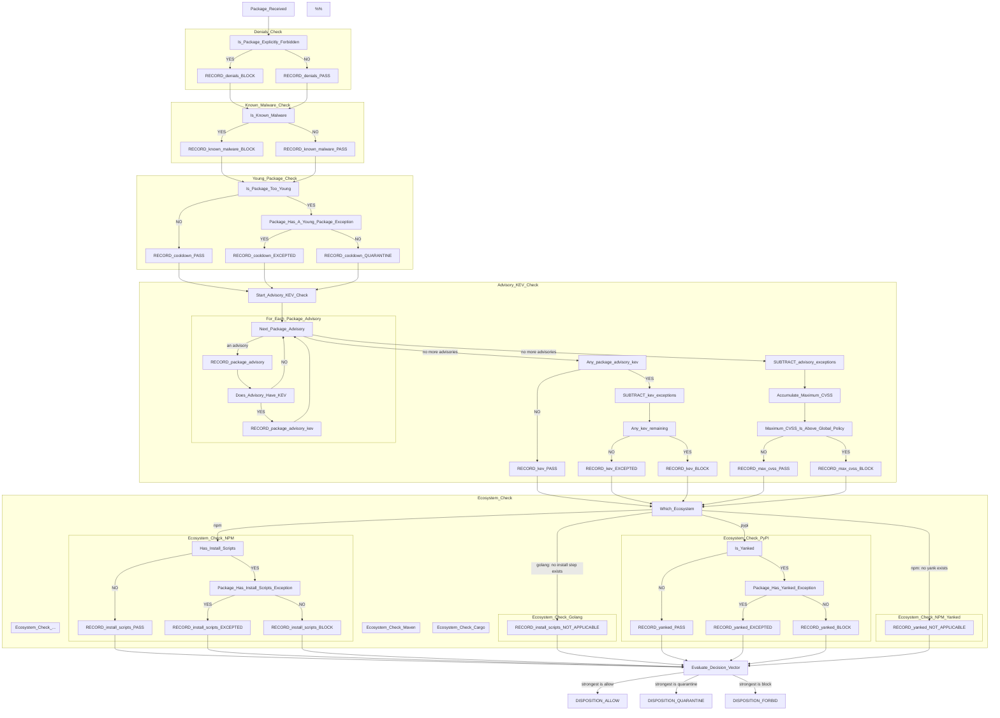

# Policy shape and how a package is judged

- **Status:** Decided. Plan §5 rewritten to match; the old §5.5 is gone.
- **Plan reference:** §5
- **Related:** [package-override-tier](package-override-tier.md),
  [policy-engine-hand-rolled](policy-engine-hand-rolled.md)

The flow chart below is the decision. Everything after it follows from it.

## Decision flow chart for what packages are delivered or rejected



### NOTES

The following settings are configurable in policy:

1. The CVSS threshold for an Allow disposition. At or below is allowed, above is forbidden. Global setting.
2. The age threshold for the Is_Package_Too_Young check (typically 7 days). Global setting.
3. Packages that are allowed to be younger than the exception. Package-specific setting.
4. Packages that are allowed even with KEVs.
5. Packages that are allowed even with specific vulnerability advisories, named by id.
6. Packages that are allowed to have install scripts (ecosystem-dependent, package-specific setting).
7. Packages that are explicitly forbidden.

## The policy file

```yaml
version: 1

# Thresholds. One value each for the deployment.
cooldown_days: 7           # note 2
max_cvss: 6.9              # note 1

# Whether these checks run. One value each for the deployment.
install_scripts: block
kev: block

# Explicitly forbidden. Exact versions, permanent, absolute. Note 7.
denials:
  - purl: "pkg:npm/evil@1.0.0"
    reason: "malware"

# Exceptions, notes 3 to 6. Per package. May only loosen.
packages:
  - match: { ecosystem: npm, name: "@mycompany/*" }
    set: { cooldown_days: 0 }
    reason: "published by our CI"
    permanent: true

  - match: { ecosystem: npm, purl: "pkg:npm/legacy-thing@2.1.0" }
    set: { kev: allow, vuln_advisory_ids: ["CVE-2024-1234"] }
    reason: "mitigated by network policy"
    expires: "2026-11-30"

# Scores for advisories no stream scored. max_cvss refuses an unscored advisory until an
# entry here names it. Per advisory.
advisory_scores:
  - advisory_id: "GHSA-xxxx-xxxx-xxxx"
    cvss: 5.3
    reason: "vendor advisory scores it 5.3"
    expires: "2026-11-30"
```

Every setting is global. Every exception is per package. Nothing is per ecosystem.

| | scope | may be excepted |
|---|---|---|
| known malware | not configurable | no |
| `denials` | per package | no |
| `cooldown_days` | global | yes, note 3 |
| `kev` | global | yes, note 4 only; a `vuln_advisory_ids` exception does not reach it |
| `max_cvss` | global | yes, per advisory id, note 5 |
| `advisory_scores` | per advisory | no. Scores an advisory `max_cvss` would otherwise refuse as unscored; needs `expires` or `permanent: true` |
| `install_scripts` | global | yes, note 6 |

`install_scripts` and `kev` take `block` or `allow`, and nothing else. `quarantine` is
meaningless for both: waiting does not change whether a package has an install script or
a KEV.

A `packages` entry that changes nothing is **valid**. It warns at load and `doctor` flags
it, because it is almost always a selector that no longer matches what it was written
for, but it does not stop a policy from loading.

## What is not configurable, and why

**Known malware always blocks.** No setting, no exception. The chart gives it no exception
branch and the notes do not list it, which makes it behaviour rather than policy.

**Which ecosystems run which check.** `install_scripts` is a global setting asked of every
ecosystem, and Go has no install step to ask about. That is a property of Go, not
something an operator sets. Such a rule reports **not-applicable**, never a violation, per
§5.5's rule of the same name, which survives intact.

**Whether a check may be excepted.** Fixed by the chart. There is no floor tier: an
organisation that does not want KEV exceptions writes none.

## Actions

`allow < quarantine < block`. Three values, and each has a producer:

| | meaning | produced by |
|---|---|---|
| `allow` | delivered | everything that passes |
| `quarantine` | refused now, allowed later | a package younger than `cooldown_days` |
| `block` | refused | denials, known malware, KEV, an advisory over `max_cvss`, install scripts |

The chart's two dispositions are the delivery projection of these: FORBID is
`{quarantine, block}`, ALLOW is `allow`. `explain` has to report which of the three, or an
operator cannot tell a refusal that will lift by itself from one that will not.

`quarantine` lapses without anyone doing anything: a young package ages. That is what
separates it from `block`, and why collapsing the two into one disposition would lose the
thing an operator most needs to know.

**It is a packument filter, not an artifact refusal.** A version that is too young is
removed from the document the client resolves against, so the client picks an older one by
itself rather than failing. That is
[quarantine-filter-metadata](quarantine-filter-metadata.md), and Stage 1 already built
the mechanism as `npm::filter_unservable_versions`. `block` is the other shape: the
artifact is refused when asked for.

`warn` is not in the lattice. Nothing delivers-with-a-concern: provenance, the one
candidate, is a recorded attribute rather than an action.

## Provenance is recorded, not required

`dist.attestations` and the rest are kept on the package record and shown in `explain`.
Nothing is refused for lacking them, and there is no `provenance_required` setting.

Measured on the 138 packages of a real `npm install express eslint`, latest version of
each, straight from registry.npmjs.org:

| | of 138 |
|---|---|
| has an install script | 0 |
| has no provenance | 112 (81%) |

Of the 30 most-downloaded packages, 15 publish provenance, and that is the most
favourable sample available.

Every other check fires on a minority, which is why per-package exceptions work for them.
Requiring provenance would forbid the majority, and the exception list would become the
dependency list: 112 entries for one small install, each with a reason and an expiry
inside the 90-day ceiling. That is a lockfile maintained by hand.

It is also the one check that cannot be asked of every ecosystem: npm has
`dist.attestations`, PyPI has PEP 740 at low coverage, cargo has nothing, Maven has GPG
signatures, which are identity rather than build provenance, and Go has a checksum
database, which is tamper-evidence. A global requirement would forbid 100% of three
ecosystems.

Stage 1 already records all of it: `record::Provenance` carries `attestation_url`,
`predicate_type`, `registry_signatures` and `trusted_publisher`.

## What this changed in the plan

§5 and §5.5 described a different system. §5 has been rewritten and §5.5 removed:

| the plan said | now |
|---|---|
| `ecosystems:` overrides global rules per ecosystem | no per-ecosystem settings exist |
| `floor:`, mandatory per enabled ecosystem, startup failure if missing | no floor tier |
| adding an adapter breaks configs until a floor is declared | adding an adapter breaks nothing |
| `packages` handles loosening **and** tightening | loosening only; tightening is a load error |
| `allow < warn < quarantine < block` | `allow < quarantine < block` |
| `provenance_required` is a rule | an attribute of the record |
| `loosens_global` + `reason` + `expires` acknowledges an ecosystem loosening | nothing to acknowledge |
| `max_cvss` in the monotonicity table only | a real setting, note 1 |
| KEV | absent from the plan entirely |

Two things §5.5 got right and keep earning their place: **not-applicable is never a
violation**, which the redesign made more load-bearing rather than less, and
**specificity is strict subset containment, not a score**.

## KEV is asked per advisory

A KEV entry carries a `cveID`, a vendor and a product, and **no package identifier of any
kind**, checked across all 1,709 entries. It cannot be asked "what is wrong with this
package", only "is this CVE known to be exploited", so it is asked once per advisory inside the
loop rather than once per package before it. See
[advisory-stream-licences](advisory-stream-licences.md) for the measurement.

**The loop judges nothing.** It collects two sets, every advisory and the subset carrying a
KEV, and exceptions are applied afterwards as a set difference. So excepting an advisory by id
never reaches the KEV answer: a KEV-listed advisory needs **both** exceptions to pass, the id in
`vuln_advisory_ids` for its score and `kev: allow` for its exploitation.

Gathering before subtracting is what makes that true by construction rather than by the
order two branches happen to sit in. The two chains that follow are independent, and
neither reads the other's result.

The two say different things and are not each other's evidence. "This advisory is not
reachable from our code" is a claim about the package in its place in a particular
codebase. "This vulnerability is being exploited in the wild" is a fact about the world
that holds whatever the code does. An operator who has convinced themselves of the first
has said nothing about the second, and letting one stand for the other would turn the
narrow exception into a way of dismissing the broader finding by accident.

**A KEV-listed advisory still contributes its score** unless its id is excepted. Being
exploited does not remove it from the `max_cvss` comparison, so a package excepted from
`kev` can still be refused for the same advisory's score. The two checks are separate
results in the vector and both are reported.

The package-level KEV exception in note 4 is the only way to except a KEV. There is no
per-advisory form, which keeps the wholesale acknowledgement wholesale: an operator accepting
exploitation does it once, for the package, rather than enumerating ids that change as new
advisories are published.

Writing it as a subtraction rather than a flag costs nothing and leaves the per-advisory form
available: a package-level exception is the difference against the whole set, and a
per-advisory one would be the difference against a list. The chart does not have to change if
that is ever wanted.

**"None at all" and "all of them excused" are different answers.** The exploitation chain
asks whether there were any KEVs before subtracting as well as whether any remain after,
because only the second is an exception doing work. Collapsing them would lose the signal
that finds a dead exception.

## Evaluation

Every check runs. Each returns a result, and the decision is taken from the whole vector
rather than at the first failure.

```
  denials          passed
  known_malware    passed
  cooldown_days    failed    -> quarantine    (published 2 days ago, needs 7)
  kev              excepted  -> allow         (packages[3], expires 2026-11-30)
  max_cvss         passed
  install_scripts  failed    -> block         (no exception)

  decision: block
```

The decision is the **strongest action in the vector**, `max` over
`allow < quarantine < block`. `Action::strength` is already proved to be that order.

**The outcome is identical to stopping at the first failure.** Every check must pass for a
package to be delivered, so the decision is a plain conjunction, and evaluating it eagerly
or lazily gives the same answer for every input. What changes is what is known when the
answer is given:

- **Every reason, not the first.** A package both too young and carrying a KEV reports
  both. Under a short circuit it reports only "too young", the reason that lapses on its
  own; an operator grants the age exception and finds it still refused, for a reason they
  see only then.
- **`explain` is the vector.** There is nothing to reconstruct or re-run.
- **`policy diff` gets finer.** Comparing verdicts says a package changed; comparing
  vectors says which check changed, which is the actionable half.
- **Observe-only is "compute it, record it, deliver anyway"**, not a second path through
  the engine.
- **`quarantine` stays distinct from `block`.** A package refused only for being too young
  clears by itself; one refused for a KEV does not. The chart's two dispositions lose that
  difference and an operator needs it.

### Four results, not two

| result | meaning | contributes |
|---|---|---|
| `passed` | the check had nothing against this package | `allow` |
| `failed` | it did | its action: `quarantine` or `block` |
| `excepted` | it did, and a `packages` entry excused it | `allow` |
| `not_applicable` | the check has no meaning for this ecosystem | `allow` |

Three of the four contribute `allow` and are distinguished anyway, because what an
operator needs to know is not the same as what the decision needs.

`excepted` is not `passed`. A check that failed and was excused is the one carrying
operational risk, and it is what an audit trail and an expiry review have to find.
Recording it as `passed` throws that away, and it is also how a dead exception becomes
visible: one that never reaches `excepted` is doing no work.

`not_applicable` is not `passed` either. "This package has no install script" and "this
ecosystem has no install step" are different facts, and reporting the second as the first
would claim a check ran that never could. This is §5.5's not-applicable rule, which is
why it survived everything else in that section.

### Where the short circuit survives

In front of expensive analysis, and nowhere else. None of the seven checks here costs
anything worth deferring for once its facts are in hand: denials and malware are set
lookups, KEV and advisories are lookups in a local mirror, age is arithmetic, install
scripts is a packument field. No extraction among them.

Gathering one fact does cost a request. `cooldown_days` needs publish times, which only the
full packument carries, measured at 1.7x to 3.6x the abbreviated one. `publish_times_for` in
`src/proxy.rs` fetches it once per package when the policy uses a cooldown, before any check
runs, and keeps it for up to 1,024 packages. It is fetched even when another check already
blocks the version, so the vector reports the cooldown's real result rather than
`unenforced`. Decided 2026-09-15: skipping it is not the short circuit this section keeps.

### A check whose fact is missing

`decide` answers every check, and a missing fact takes the safe direction: an unknown
publish date is not old enough, so `cooldown_days` fails. The proxy would then refuse every
package on a fact the registry never sent. `enforce::unenforceable` names the checks whose
fact is missing, and `enforce::enforced` removes them from the decision the proxy acts on.
They are reported as `unenforced`, never as `pass`, and startup names the settings that are
configured and inert. With no intel store, `max_cvss`, `known_malware` and `kev` are
unenforceable, because an empty advisory list is an absent answer; with a store that has not
loaded the KEV catalogue, `kev` is. `explain` and `policy diff` report the action from
`enforced`, so neither names a verdict the proxy does not reach.

Stage 4's detectors are different. Capability analysis and source diff are the "expensive
analysis" §5 defers a request for, and they stay lazy: the cheap checks are a vector, and
anything expensive runs only if that vector has not already settled the answer.

## What this means for the code

| | |
|---|---|
| `selector.rs` | kept whole. The exception lists are selectors and still have to be orderable. |
| `packages.rs` | kept. The exception tier is now the entire configurable surface. |
| `strictness.rs` | kept, minus `Warn`. `packages` may only loosen, so tightening has to be detected to refuse it. |
| `merge::applies` | kept. Not-applicable is why. |
| the rest of `merge.rs` | deleted. Nothing to merge. |
| `floor`, `check_floors`, `check_enabled` | deleted. |
| `ecosystems`, `EcosystemRules` | deleted. |
| `ScriptDetail`, `ScriptRule`'s hand-written `Deserialize` | deleted. |
| `Action::Warn` | deleted. |
| `Action::strength` | the combiner: the decision is `max` over the vector. |
| the engine | returns a vector of per-check results, not a verdict. `explain`, `policy diff` and observe-only all read it. |
| `npm::filter_unservable_versions` | reused. `quarantine` is a packument filter, which is what it already does. |

`ScriptRule` is polymorphic only because its detailed form carried the acknowledgment, and
nothing acknowledges now. A `packages` entry carries its own `reason` and `expires` at
entry level, so `set: { install_scripts: allow }` needs no inner table, and `ScriptRule`
becomes an `Action`.

The measurement behind that deserialiser stands on its own and is worth keeping: an
`untagged` enum refuses a typo'd key but names neither the key nor the right line. The
next polymorphic field will need the hand-written form.
