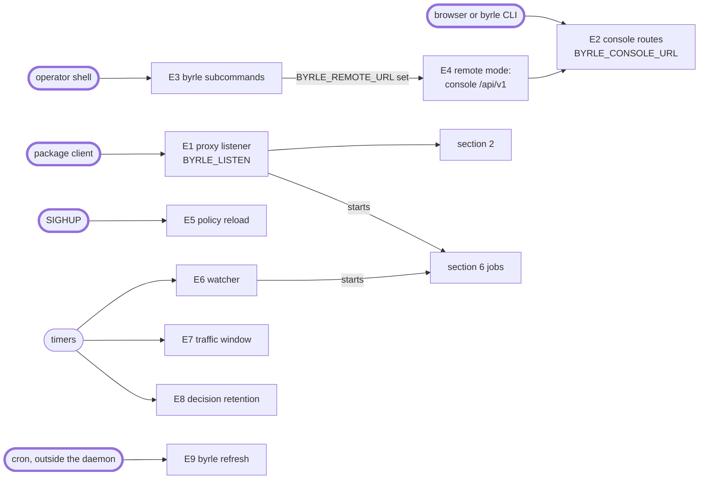
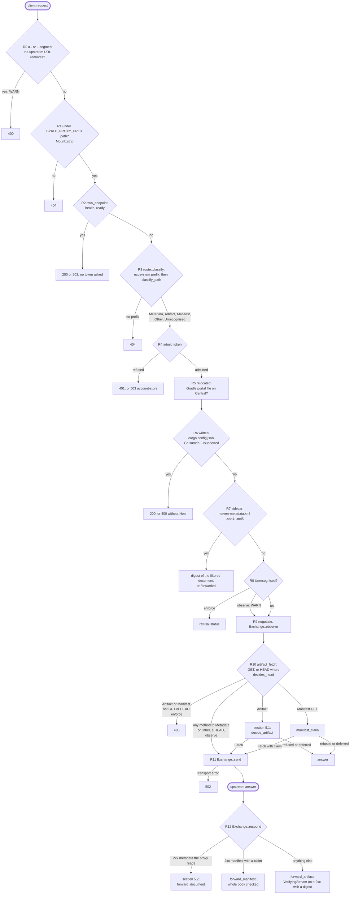
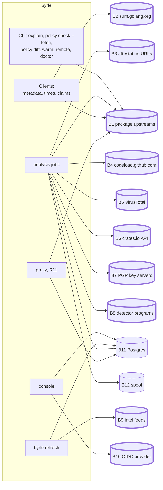
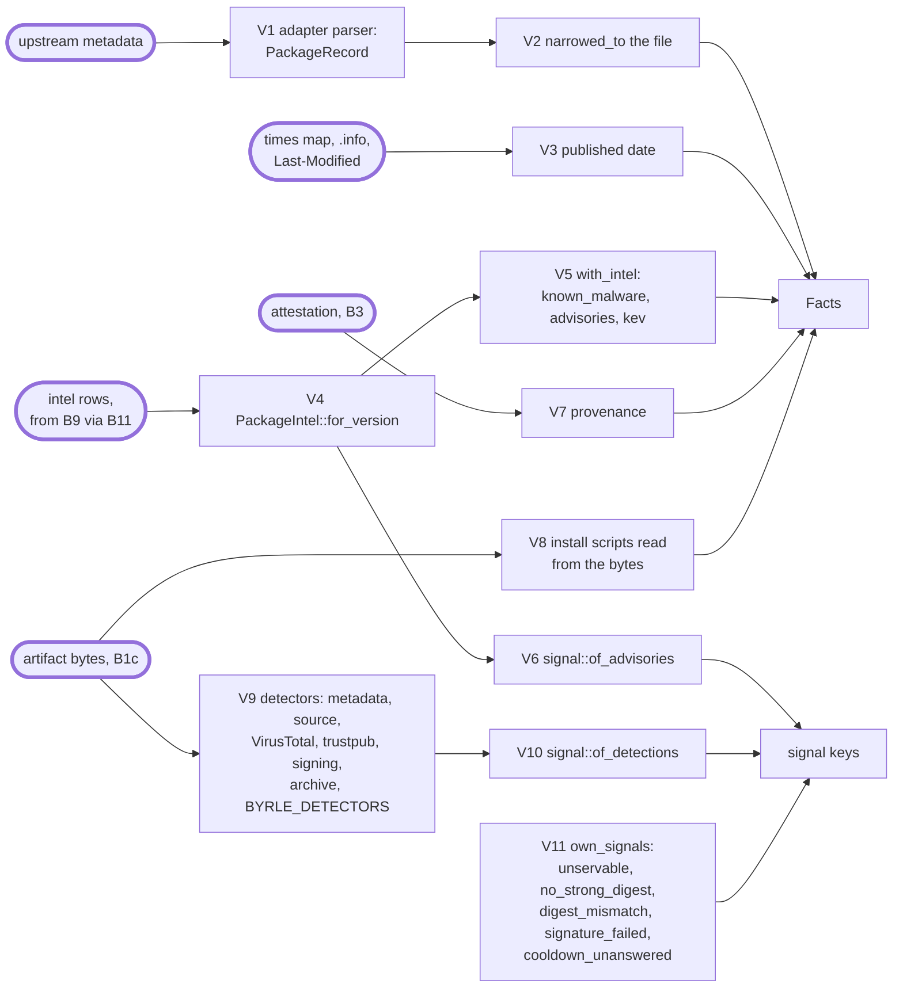
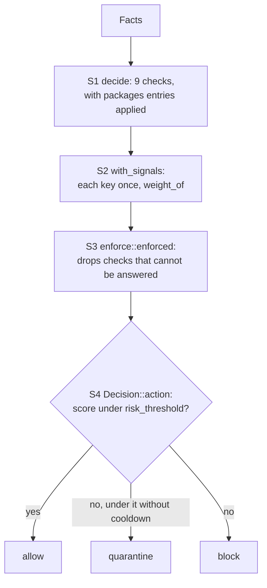

# Logic flow

Every way into byrle, every request it makes to a backend, how a version's risk vector and
score are built, the decision, and the response. Read from the code at `3ade87d` on
2026-10-19, for TODO.md ad-hoc #49. [request-flow](request-flow.md) has the proxy's
answer to one request, status by status. This document links to it rather than redrawing it.

Each step has an ID, such as `R4` or `S3`, so a review can name it. In the diagrams, a node
with a thick border is where data from outside byrle enters: a client's request, an
upstream's metadata or bytes, an intel feed, a third-party API's answer, or a file an
operator writes.

Functions are in `src/proxy.rs` unless a file is named.

## 1. Entry points

| ID | Entry | Code | Input it reads | Auth |
|---|---|---|---|---|
| E1 | Proxy listener, `BYRLE_LISTEN`, default `127.0.0.1:8080`. Any method on `/` and `/{*path}` | `Proxy::router`, `handle` | method, path, query, `User-Agent`, `Accept`, `Accept-Encoding`, `If-None-Match`, `If-Modified-Since`, the token headers; `Host` and forwarded headers when `BYRLE_PROXY_URL` is unset | token, unless `BYRLE_REQUIRE_TOKEN=0`; no role |
| E2 | Console: 35 routes in `ROUTES`, under `BYRLE_CONSOLE_URL`, on `BYRLE_CONSOLE_LISTEN` or in front of the proxy on E1 | `console/routes.rs` `ROUTES`, `guarded` | cookie `byrle_session` or a token; `x-byrle-csrf` or a `csrf` field on a session's non-GET; JSON and form bodies; `POST /api/v1/policy/check` and `/diff` take a policy of up to 16 MiB | 11 routes none or any caller, 24 a permission; `reader` holds every one a route asks |
| E2a | OIDC login and callback | `console/pages.rs` `oidc_login`, `oidc_callback` | the provider's redirect query, its discovery document, JWKS and token answer | none |
| E3 | `daemon`, `doctor`, `status`, `explain`, `audit verify`, `policy check`, `policy diff`, `intel history`, `lockfile verify`, `warm`, `refresh`, `account`, `token`, `artifact` | `main.rs` `main`, `cli.rs` `Command` | arguments, policy files, lockfiles, audit logs, `DATABASE_URL`, stdin for `account password` | the shell's |
| E4 | Remote mode of `status`, `explain`, `policy check`, `policy diff`, `intel history`, `artifact show` and `export` | `main.rs` `remote`, `remote.rs` `Remote::from_env` | `BYRLE_REMOTE_URL` (https, or http to loopback), `BYRLE_TOKEN` | a token, then E2's permission |
| E5 | SIGHUP | `startup.rs` `reload_on_hangup`, `reload_policy`, then `Proxy::replace_policy` | the `BYRLE_POLICY` file | the process owner |
| E6 | Watcher, every `BYRLE_WATCH_INTERVAL` s, default 900, 0 turns it off | `Proxy::watch`, `watch_version` | each held package's metadata, fetched again | |
| E7 | Traffic window, every 600 s | `report_traffic` | the proxy's counters | |
| E8 | Decision retention, daily | `analysis/run/recording.rs` `forget_decisions_daily` | `BYRLE_DECISION_RETENTION_DAYS`, default 365 | |
| E9 | Intel refresh. The daemon never refreshes intel itself | `intel/refresh/run.rs` `run` | the feeds of section 3 | |

At startup the daemon reads the policy file, the CA bundle, the spool directory, the audit
and account event logs, and runs each detector program once for its version
(`startup.rs` `proxy`). It connects to Postgres and runs the migrations
(`intel/postgres.rs` `from_env`). It has no SIGTERM handler and serves no TLS itself.

## 2. Proxy request path

`handle`, in order. [request-flow](request-flow.md) has the status each step answers.

| ID | Step | Code | Notes |
|---|---|---|---|
| R0 | Dot segments | `route::rewritten_by_url_parser`, `rewritten` | every mode; `%2e` in any case, `/` or `\` between segments; the query is not read |
| R1 | Mount | `Mount::strip`, `outside_mount` | |
| R2 | Own paths | `own_endpoint`, `Proxy::health`, `Proxy::readiness` | any method, before the token |
| R3 | Classify | `route::classify`, each adapter's `classify_path` | a name `ecosystem::askable` refuses is not read here; a path no adapter lists is `Unrecognised` ([0119](engineering_decisions/0119-unrecognised-paths-refused.md)) |
| R4 | Token | `admit`, `account/gate.rs` `Gate::admit`, `PgAccounts::holder` | one store query per request; forms in [request-flow](request-flow.md#tokens) |
| R5 | Relocate | `relocated`, `maven/transport.rs` `located` | `/gradle-plugins/` only: a HEAD upstream, whose final URL after redirects decides |
| R6 | Proxy-written | `written` | |
| R7 | Computed sidecar | `sidecar`, `sidecar_document` | fetches and filters the document, writes no audit line |
| R8 | Unrecognised | `unrecognised` | |
| R9 | Negotiate | `negotiate`, `Exchange::observe` | whether the proxy reads the document: needs an `Accept-Encoding` it can decode |
| R10 | Decide | `Exchange::artifact_fetch`, `method_not_allowed` | `decides_head` is true for Maven only; an artifact or manifest asked with another method is 405, forwarded in observe mode |
| R11 | Send | `Exchange::send`, `upstream_url`, `upstream_headers` | only the headers in `FORWARDED`; no request body; redirects followed, up to reqwest's 10 |
| R12 | Respond | `Exchange::respond`, `forward_document`, `forward_manifest`, `forward_artifact` | |

Debug builds answer `BYRLE_DEFER_TEST` between R8 and R9.

## 3. Requests to backends

Clients (`http.rs` `client_builder`): the daemon's and the refresh's connect
in 10 s, wait 30 s per read and have no total timeout. The CLI's `Clients::from_env` sets no
timeout. No production client sets a redirect policy, so each follows up to 10 redirects.

| ID | Backend | Asked by | URL from | Body read |
|---|---|---|---|---|
| B1a | npm, PyPI, cargo, Go, Maven, Gradle portal, as the client asked | `Exchange::send` | the client's path through each adapter's `upstream_url`; files.pythonhosted.org, static.crates.io and sum.golang.org are fixed | document and manifest: `buffer_to_limit`, `BYRLE_MAX_METADATA_BYTES`, default 64 MiB; artifact: streamed, no limit |
| B1b | the same, for the proxy's own reads: npm packument, PyPI index, cargo index file, Go `@v/list` and `.info`, `maven-metadata.xml`, Maven `.pom` HEAD, sidecars, `.asc`, a file's `Last-Modified` | `Clients` (`ecosystem.rs`), `fetch_and_store`, `full_document`, `dated_by_host`, the watcher | the package key, or a URL in the metadata | metadata: whole, then `decode_for_parsing` limits the decoded size; Go `.info`, Maven sidecars and `.asc`: whole, no limit |
| B1c | the artifact, for analysis | `analysis/run.rs` `Analyser::fetch` | the upstream URL the client's request maps to | spooled, `BYRLE_MAX_ARTIFACT_BYTES`, default 1 GiB |
| B2 | `https://sum.golang.org` lookup and tiles | `ecosystem/go/sumdb.rs` `Client::get` | module and version | whole, no limit; note signature and tree proofs checked (`note.rs`, `tlog.rs`) |
| B3 | npm and PyPI attestation documents | `Analyser::attestation_document` | `provenance.attestation_url` from the metadata, kept only on a served origin (`attestation_url`) | whole, no limit; verified against `sigstore-verify`'s built-in trust root |
| B4 | source archive | `analysis/run/sourcing.rs` `Analyser::archive` | the metadata's repository, `source.rs` `Repo::archive_url`, under `BYRLE_SOURCE_ARCHIVES`, default `https://codeload.github.com`; `off` fetches nothing | spooled; tree read up to 512 MiB |
| B5 | VirusTotal API v3: file lookup, upload URL, upload, analysis | `analysis/virustotal.rs` | the artifact's sha256; the large-file upload URL is VirusTotal's answer | whole, no limit; `x-apikey` on each request |
| B6 | `crates.io/api/v1/crates/<name>/versions` | `ecosystem/cargo/trustpub.rs` `TrustPub::page` | crate name; `meta.next_page`, up to 20 pages | whole, no limit |
| B7 | keys.openpgp.org, keyserver.ubuntu.com | `ecosystem/maven/keys.rs` `KeyServers::copy` | the `.asc`'s issuer | whole, no limit |
| B8 | `BYRLE_DETECTORS` programs, as subprocesses | `analysis/detector.rs` `Command::run` | the ecosystem, name and version, as arguments; the program fetches its own copy | stdout and stderr up to 16 MiB; cleared environment, 0700 working directory, killed on timeout; a non-zero exit stores nothing |
| B9 | OSV bundles, CISA KEV, Datadog manifests, GitHub GraphQL | `intel/fetch.rs` `bundle`, `graphql` | `intel/stream.rs`; `BYRLE_STREAM_URLS` replaces any | OSV 512 MiB, each zip entry 16 MiB; KEV and Datadog 16 MiB; GitHub 64 MiB over all pages, each page read whole first; a stream that parsed to under half its source's stored rows is not loaded, unless `--force` lists it |
| B10 | OIDC discovery, JWKS, token endpoint | `console/oidc.rs` `Provider::fetched`, `exchange` | `BYRLE_OIDC_*`; endpoints must pass `http::trusted` | 256 KiB |
| B11 | Postgres, one pool | `intel/postgres.rs`, `analysis/postgres.rs`, `account/postgres.rs`, `usage/postgres.rs` | `DATABASE_URL` | tables below |
| B12 | spool, `BYRLE_SPOOL_DIR` | `spool.rs` `Spool::open`, `write_chunks` | | 0700 directory, refused when a symlink, another owner's or world-writable; files 0600 |

| Store | Tables written | Read by |
|---|---|---|
| `intel/postgres.rs` | `advisory`, `advisory_alias`, `advisory_affected`, `advisory_range`, `exploited_cve`, `intel_source`, `intel_snapshot`, `intel_ingestion` (E9 only) | every decision, `PgIntel::package`; readiness, `snapshot` |
| `analysis/postgres.rs` | `artifact_analysis`, `artifact_install_script`, `artifact_attestation`, `artifact_source`, `version_detection`, `artifact_virustotal`, `virustotal_request`, `artifact_decision`, `artifact_claim`, `artifact_signature` | section 5.1 `Deciding`; `byrle artifact` |
| `account/postgres.rs` | `account`, `account_role`, `account_password`, `account_oidc`, `proxy_token`, `session` | R4 `holder`; console login |
| `usage/postgres.rs` | `served_version`, `failure_count` | console dependencies and failures |

## 4. Risk vector

The vector for one version is a `Facts` (`policy/decide.rs`) and a list of signal keys.

| ID | Input | Code | From |
|---|---|---|---|
| V1 | `PackageRecord`: `published_at`, `yanked`, `deprecated`, `has_install_scripts`, `install_scripts`, `provenance`, `integrity`, `repository` | npm `normalize.rs` `version_record`; PyPI `normalize.rs` `normalize`; cargo `wire.rs` `record`; Go `wire.rs`; Maven `wire.rs` | the metadata document. npm reads `hasInstallScript` and the three script keys; PyPI marks scripts when a version has sdists only; cargo, Go and Maven publish none |
| V2 | the requested file's own scripts, yanked, attestation and, on PyPI, publish time (0124) | `record.rs` `PackageRecord::narrowed_to`, called in `Deciding::locate` | when the record names no file by the requested name, the version's first file is used |
| V3 | `published` | `policy/facts.rs` `published_date`; `dated_versions`; `dated_by_host` | `published_at`, else the separately fetched times, else a HEAD's `Last-Modified` when they lack the version, else, under a cooldown on a pinned fetch, the file's first sighting in `artifact_first_seen` (0129). A PyPI version's is its oldest file's `upload-time`; a PyPI file in a version the policy serves is decided again on its own `upload-time`, and removed alone from the index when refused (0124). A Go version under a cooldown is dated by the first tree of sum.golang.org that holds its record, rows read from index.golang.org until they are an hour apart; below the seed row, the earlier of its `.info` `Time` and the seed (0125) |
| V4 | intel rows for the version | `intel/store.rs` `PackageIntel::for_version`, `intel/range.rs` `Interval::contains`, `VersionOrder` | exact string, equal in the ecosystem's order, or inside a range; SemVer, PEP 440, Go or Maven order |
| V5 | `known_malware`, `advisories` (merged by id, highest CVSS, `kev` OR'd), `intel` | `policy/facts.rs` `with_intel` | informational rows are dropped here |
| V6 | `advisory_malware`, `_vulnerability`, `_unsound`, `_unmaintained`, `_notice` | `signal.rs` `of_advisories` | all rows, informational ones included |
| V7 | `provenance` | metadata: `analysis/attestation.rs` `from_metadata`; pinned fetch: `Deciding::attested` | |
| V8 | `has_install_scripts` OR the analysis's; `install_scripts_analyzed`; the analysis's anomalies | `Deciding::analysed`; `analysis.rs` `npm_install_scripts`, `sdist_install_scripts`, `crate_build_scripts`, `jar_annotation_processors` | a tarball is read through every gzip member and past a single zero block, and every copy of a manifest counts (0122). A root `binding.gyp` with no `install` or `preinstall` is `install: node-gyp rebuild` (0123). A `.crate` is a proc-macro by `proc-macro`, `proc_macro`, `crate-type` or `crate_type`. An artifact over the spool's ceiling, or decompressing past 4 GiB, is `Unreadable`, which counts as install scripts |
| V9 | detections | `Deciding::detections`; `analysis/detector/*.rs` | pinned fetch only. `archive` reads V8's anomalies |
| V10 | detector signal keys, `<detector>.<rule>` | `signal.rs` `of_detections`, `detector.rs` `key` | a command's run whose `errors` names a rule adds `<detector>.error` |
| V11 | the proxy's own | `Deciding::own_signals`; `signature_failed` for manifests in `signed_manifest` | |

A metadata document's versions get V1, V3, V4 to V6, and V7 from metadata alone. They get
no V8 to V11.

## 5. Score, decision and response

### Score

| ID | Step | Code | Rule |
|---|---|---|---|
| S1 | Checks: `denied`, `known_malware`, `cooldown`, `kev`, `max_cvss`, `install_scripts`, `yanked`, `deprecated`, `provenance` | `policy/decide.rs` `decide`, `Applied::of`, `matching`, `on_off` | a failed check adds its weight unless its action is `allow`; `merge::applies` makes a check meaningless for an ecosystem `NotApplicable`; an unknown publish date fails a non-zero cooldown, and S3 then drops the check; an unscored advisory fails `max_cvss` |
| S2 | Signals | `Decision::with_signals`, `Policy::weight_of` | default weights in `decide::default_weight` and [policy-reference](policy-reference.md#signal_weights): each check and the proxy's own weigh `risk_threshold`, but `no_strong_digest` 0, `provenance_dropped` half and `provenance_surprise` a quarter per bit; detector signals 1; advisories 8, 4, 3, 2, 1 |
| S3 | Unanswerable checks | `policy/enforce.rs` `enforced`, `unenforceable` | removed: install scripts not analysed, provenance unknown, no date with a cooldown (on a pinned fetch, V11's `cooldown_unanswered` weighs it instead, 0129), intel not consulted (malware, KEV, CVSS), KEV with no exploitation stream |
| S4 | Action | `Decision::score`, `Decision::action` | the sum of check and signal weights; a tie refuses; quarantine when the score without `cooldown`'s weight is under the threshold |

`risk_threshold` is 100 by default and may not be 0 (`policy.rs`). Two other sums are
reported, and neither refuses anything:

| Where | Code | Sum |
|---|---|---|
| log field `byrle.risk_score`, audit line `risk_score` | `signal::score` | signals only, `signal::default_weight`: no check weights, and the proxy's own weigh 1 |
| `byrle explain`'s "risk score X of Y" | `explain.rs` | `Decision::score` before S3 |

### 5.1 Pinned artifact

`decide_artifact`, then `Deciding`.

| ID | Step | Code | Answer when it stops here |
|---|---|---|---|
| A1 | Metadata for the package, held or fetched (B1b) | `Deciding::locate` | 502 when the registry gave none; refusal status when it does not list the version |
| A2 | Claim: Go sum.golang.org (B2), Maven sidecars | `Deciding::claimed`, `checked` | 503 `checksum-database` when it cannot be read |
| A3 | Digest | `fetch_plan`, `digest`, `integrity.rs` `Sri::parse` | sha256, sha384 or sha512; SHA-1 alone is none |
| A4 | Facts and stored results: dated, sourced, scanned, detected, analysed | `Deciding::dated` to `analysed`, `own_signals` | A Go record from `Deciding::locate` is already dated by `Fetch::version` with `cooldown_start` (0125) |
| A5 | Intel, S1 to S4 | `Deciding::refusal`, `enforce::artifact`, `intel_for` | 503 `intel-store` or `no-stream-for-ecosystem` |
| A6 | Answer, first that applies: policy refusal (enforce mode); own signals with the policy; unservable; claim failed or pending; no digest; mismatched bytes; analysis pending; awaited detector | `Deciding::answer` | refusal status, 502 or 503 as [request-flow](request-flow.md) draws |
| A7 | Fetch and stream | `forward_artifact`, `VerifyingStream`, `verified.rs` | the last chunk is held until the digest matches; a mismatch cuts the body |
| A8 | Audit and decision row | `pinned_line`, `audit.rs` `Event::pinned`, `analysis/decision.rs` `Decided::of` | written after the upstream answers |

A block starts no scan, source comparison or detector run (`Deciding::blocks`).

### 5.2 Metadata document

`forward_document`, then `filtered_document`.

| ID | Step | Code | Notes |
|---|---|---|---|
| D1 | Buffer | `buffer_to_limit` | over `BYRLE_MAX_METADATA_BYTES`: forwarded unread, no audit line |
| D2 | Decode and read | `http::decode_for_parsing`, the row's `read` | undecodable or unread: forwarded unchanged |
| D3 | Dates, when a cooldown is in use | `dated_versions` | |
| D4 | Intel | `intel_for` | store error: 503; a gap: 503 for npm, filtered without intel for PyPI, cargo, Go and Maven (`UncoveredMetadata`) |
| D5 | Each version through S1 to S4 | `policy_refused_versions` | metadata facts and advisory signals only; observe mode removes none |
| D6 | Go `@latest` naming a refused version | `names_refused` | 404 |
| D7 | Rewrite | npm `rewrite.rs` `rewrite_packument`; PyPI `rewrite.rs` `rewrite_index`; cargo, Go, Maven `inspect.rs` | npm and PyPI also remove a version with a file on an origin the proxy does not serve, when `refuse_unservable`, and repoint artifact URLs; cargo, Go and Maven only remove refused versions |
| D8 | Headers | `mark_filtered`, `finish` | `x-byrle-filtered-versions` and `-checks` count policy refusals only; the upstream's digest headers are removed; the upstream's 2xx status |

## 6. Background jobs

Started by A6 and by the watcher (E6), each a `tokio::spawn`, one per digest.

| ID | Job | Code | Backends | Slots |
|---|---|---|---|---|
| J1 | Analysis: fetch, spool, digest, install scripts, attestation | `analysis/run.rs` `Analyser::start` | B1c, B3, B12, B11 | `BYRLE_MAX_CONCURRENT_ANALYSES`, default 8; 600 s deadline |
| J2 | Claim: Go `h1:`, Maven signature | `analysis/run/claiming.rs` | B1, B2, B7 | shares J1's |
| J3 | Source comparison | `analysis/run/sourcing.rs` | B4 | 2, unless `BYRLE_SOURCE_ARCHIVES=off` |
| J4 | Detectors and publisher lookups | `analysis/run/detecting.rs` | B6, B7, B8 | 2 |
| J5 | VirusTotal | `analysis/run/virustotal.rs` | B5 | 1, only with `BYRLE_VIRUSTOTAL_API_KEY`; 4 a minute, 500 a day |
| J6 | Recording | `analysis/run/recording.rs` `Analyser::record`, `util/batched.rs` | B11 | queue of 4096, batches of 256 |

## 7. What changes or skips a score

| ID | Path | Code | Effect |
|---|---|---|---|
| O1 | A `packages` entry's `allow` | `decide.rs` `on_off` | `kev`, `install_scripts`, `yanked`, `deprecated`, `provenance` weigh 0 for it |
| O2 | A `packages` entry's `cooldown_days` | `decide.rs` `cooldown_days` | a shorter wait |
| O3 | `ignored_vuln_advisory_ids` | `decide.rs` | excuses `max_cvss` only; `kev` and `advisory_*` stay |
| O4 | `advisory_scores` | `decide.rs` `score` | a score for an advisory with none stored |
| O5 | A check set to `allow` globally | `on_off` | the check is off |
| O6 | `signal_weights` | `Policy::weight_of` | any key, `denied` and `known_malware` included, may weigh 0 |
| O7 | S3's dropped checks | `enforce::enforced` | |
| O8 | `BYRLE_MODE=observe` | `refusal.rs`; `answer`, `policy_refused_versions`, `unrecognised` | a policy refusal is logged; documents keep every version; the proxy's own signals still refuse alone |
| O9 | Break-glass: edit the policy, then SIGHUP (E5) | [break-glass](break-glass.md) | |
| O10 | No policy | `enforce.rs` | everything is served, no intel asked |

`packages::check` refuses an entry that tightens, and one that loosens with neither
`expires` nor `permanent`. No entry can excuse `denied` or `known_malware`.

Forwarded with no policy decision:

| ID | Request | Code |
|---|---|---|
| F1 | Any method to a metadata or `Other` path; a HEAD but a Maven artifact's; an artifact or manifest asked with another method in observe mode | `Exchange::artifact_fetch` |
| F2 | A listed `Other` shape: npm `/-/` endpoints, PyPI `/simple/` and `.metadata`, Go `.info` and checksum database, Maven sidecars and `.asc` | each `classify_path` |
| F3 | An unrecognised path in observe mode | `unrecognised` |
| F4 | A document over the size limit, undecodable, or not read (D1, D2, R9) | `forward_document`, `filtered_document`, `negotiate` |
| F5 | A non-2xx or 304 answer | `Exchange::respond`, `forward_artifact` |
| F6 | No strong digest, while `no_strong_digest` weighs 0 by default; a manifest with no claim | `Deciding::answer`, `unclaimed` |
