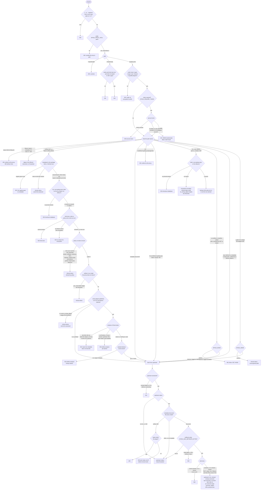

# Request flow

How the proxy answers one request, and where each status code comes from. Every path
below is read from below `BYRLE_PROXY_URL`'s path: `/registry/npm/lodash` is `/npm/lodash`
under `https://h/registry/`. Each ecosystem is served under its own prefix, `/npm/`,
`/pypi/`, `/cargo/`, `/go/` and `/maven/`, and the Gradle plugin portal under
`/gradle-plugins/` ([ecosystem-path-prefixes](engineering_decisions/0111-ecosystem-path-prefixes.md)).
Read from
`handle`, `admit` and `Exchange`, `decide_artifact` and `Deciding`, and `filtered_document`
in `src/proxy.rs`, on 2026-09-28, `admit` on 2026-10-11, Go's claim on 2026-10-16, and
Maven's on 2026-10-17 ([maven-plan](maven-plan.md) step 4.3), and `unrecognised` on
2026-10-19. Checked against the code at `3ade87d` on 2026-10-19 for
[logic-flow](logic-flow.md).

With `BYRLE_MODE=observe`, a refusal by policy is logged at WARN and the request goes on
to the next check, and a metadata document keeps the versions the policy refuses, and an unrecognised path is
forwarded, logged at WARN. Every other answer is the same in both modes
([observe-mode](engineering_decisions/0071-observe-mode.md)).

The policy's checks, the detectors' and advisories' signals, and the proxy's own refusals
are each a signal with a weight, and a version is refused when the weights present sum to
`risk_threshold` ([every-refusal-a-signal](engineering_decisions/0116-every-refusal-a-signal.md)).
The proxy's own, `unservable`, `no_strong_digest`, `digest_mismatch`, `signature_failed`
and `cooldown_unanswered`, answer as drawn below when one weighs the threshold alone, which each
does by default but `no_strong_digest`, 0; reached only by a sum, the refusal is the
policy's; under it, each serves what it can, as
[policy-reference](policy-reference.md#signal_weights) says.

"Refusal status" is `BYRLE_REFUSAL_STATUS`: 403 by default, settable per ecosystem and
client to any code from 400 to 599. Every 503 carries `Retry-After` and
Every 503 the proxy writes, but `/-/byrle/ready`'s, carries `Retry-After` and
`x-byrle-not-ready` naming the case. `Retry-After` is 1, but `BYRLE_CLAIM_RETRY_AFTER`, 2 by
default, while a claim is checked, and for a download waiting on an awaited detector that
detector's runs in flight times one run's time. An `artifact-analysis` 503 also carries
`x-byrle-digest`, the digest of the artifact it waits on, as its log lines name it.

## Status codes

| Code | Produced by | When |
|---|---|---|
| 200 | proxy | health; ready; a verified artifact; a filtered and rewritten metadata document; Go's `sumdb/sum.golang.org/supported`, empty; cargo's `index/config.json`; a `maven-metadata.xml`'s `.sha1` or `.md5`, computed |
| 400 | proxy | the path has a `.` or `..` segment, which the upstream URL would remove; cargo's `index/config.json` asked with no `Host` |
| 401 | proxy | a token is required and the request has none in a form read; its token is unknown, revoked or of a disabled account; or its Basic username is not the token's account |
| 404 | proxy | the path is outside `BYRLE_PROXY_URL`'s path, or under no ecosystem's prefix; a Go `@latest` naming a version the policy refuses |
| 405 | proxy | an artifact or manifest asked with a method but GET or HEAD, in enforce mode; `Allow: GET, HEAD` |
| 304 and every other upstream status | upstream | forwarded unchanged, including a 404 for a missing document or artifact |
| refusal status, 403 by default | proxy | the path is of no shape its adapter lists, such as a PyPI `.tgz` ([unrecognised-paths-refused](engineering_decisions/0119-unrecognised-paths-refused.md)); the version's risk score reaches `risk_threshold`; its artifact is on an origin the proxy does not serve; no strong digest, while `no_strong_digest` weighs the threshold; under a cooldown, nothing dates the file, while `cooldown_unanswered` weighs the threshold; the metadata does not list the version; Go's checksum database holds no record of a `go.mod`'s version, while `no_strong_digest` weighs the threshold |
| 502 | proxy | the upstream could not be reached, or stalled before answering; a metadata body failed; the registry gave no metadata for an artifact's package; the analysis job's fetch of the artifact did not match its digest; a Go `go.mod` is not the one the checksum database claims; a Go zip that is not the one claimed, is no zip, or is over the spool's ceiling, until the process restarts; a Go version's `.info` cannot be read; a Maven `.pom` or `.module` that is not the one its sidecar claims, or whose `.asc` does not verify |
| 503 | proxy | not ready: `account-store`, `intel-store`, `no-stream-for-ecosystem`, `checksum-database`, `artifact-analysis`; `/-/byrle/ready` while a policy is set and intel has not loaded or has a gap |

An artifact whose bytes do not match the digest has already been sent a 200. The last
chunk is held back, so the body ends short and the client's install fails. A body that
fails, or stalls 30 s, after its 200 also ends short. The 502 for a
mismatch comes from the analysis job's own fetch of the same digest, which is remembered
in process.

With no stream covering PyPI, a simple index is filtered without intel rather than
answered 503, because pip reports an index 503 as `No matching distribution found`. Its
files are answered 503 ([pypi-index-filtering](engineering_decisions/0050-pypi-index-filtering.md)).
Cargo, Go and Maven documents are filtered the same way.

A Maven file's claim is the first of the `.sha512`, `.sha256` and `.sha1` beside it
([maven-digests](engineering_decisions/0112-maven-digests.md)). A `.pom` and a `.module`
are never refused by policy. With an analyser, a `.pom`'s or `.module`'s first fetch is
503 `artifact-analysis` while a job checks it against its sidecar and its `.asc`; without
one it is checked in the request against its sidecar. A jar's
first fetch is 503 `artifact-analysis` while a job reads its sidecar, its `.asc` and the
key; a jar with none of the three sidecars has no strong digest, and is forwarded unverified
unless `no_strong_digest` weighs the threshold. A sidecar and an `.asc` are forwarded. A
`HEAD` of a jar is decided as its GET is; one of a `.pom` or `.module` is forwarded.
`maven-metadata.xml` is filtered as a metadata document, and its `.sha1` and `.md5` are
computed from what the proxy serves. Under `/gradle-plugins/`, a portal 303 to `plugins-artifacts.gradle.org` names
the file's sha256 in its path, which is the claim; one to Central is decided as under
`/maven/`.

## Tokens

Unless `BYRLE_REQUIRE_TOKEN=0`, every request except `/-/byrle/health` and
`/-/byrle/ready` carries a token from `byrle token create`. The proxy reads the first of
these it finds, and only that one:

| Order | Form | Sent by |
|---|---|---|
| 1 | `X-Byrle-Token: <token>` | a client that sets a custom header; `byrle warm` with `BYRLE_TOKEN` |
| 2 | `Authorization: Bearer <token>` | npm, pnpm, yarn 1 and bun with `_authToken` or `token`; mvn and Gradle with an `Authorization` header, which was not run |
| 3 | `Authorization: Basic`, the account as username and the token as password | pip and uv with `account:token@` in the index URL; go with it in `GOPROXY`, over https only; mvn from a `<server>`, Gradle from `credentials { }` and `./mvnw` from `MVNW_USERNAME` and `MVNW_PASSWORD`, each after the 401's `WWW-Authenticate` |
| 4 | `Authorization: <token>`, the token alone, starting `byrle_` | cargo, with `auth-required` in the proxy's `config.json` |

Each request asks the account store, and keeps no answer: a revoked token or a disabled
account is refused from the next request. Neither header is sent upstream: only
`Accept`, `Accept-Encoding`, `If-None-Match` and `If-Modified-Since` are. Observe mode
does not change a 401. A store that cannot answer is 503 `account-store`, after the
database pool's wait for a connection: 30.0 s per request with Postgres stopped, measured
2026-10-11. The intel store uses the same pool.

A request the policy refuses is refused before anything is fetched, but for the detectors'
signals, known once its artifact is analysed. A version the policy
refuses is also removed from the metadata document, so a resolver picks another version
and never asks for it.

Debug builds also answer `BYRLE_DEFER_TEST`'s scripted deferrals, after the token check,
the proxy-written files and the unrecognised-path refusal, and before anything else. See
[deferral-status-codes](engineering_decisions/0021-deferral-status-codes.md).
