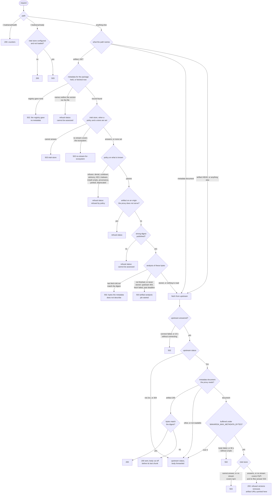

# Request flow

How the proxy answers one request, and where each status code comes from. Read from
`handle` and `Exchange`, `decide_artifact` and `Deciding`, and `filtered_document` in
`src/proxy.rs`, on 2026-09-28.

"Refusal status" is `WAHAROA_REFUSAL_STATUS`: 403 by default, settable per ecosystem and
client to any code from 400 to 599. Every 503 carries `Retry-After: 1` and
`x-waharoa-not-ready` naming the case.

## Status codes

| Code | Produced by | When |
|---|---|---|
| 200 | proxy | health; ready; a verified artifact; a filtered and rewritten metadata document |
| 304 and every other upstream status | upstream | forwarded unchanged, including a 404 for a missing document or artifact |
| refusal status, 403 by default | proxy | the policy refuses the version; its artifact is on an origin the proxy does not serve; no strong digest; the metadata names neither the version nor the file |
| 502 | proxy | the upstream could not be reached or stalled; a metadata body failed; the registry gave no metadata for an artifact's package; the analysis job's fetch of the artifact did not match its digest |
| 503 | proxy | not ready: `intel-store`, `no-stream-for-ecosystem`, `artifact-analysis`; `/-/waharoa/ready` before intel has loaded |

An artifact whose bytes do not match the digest has already been sent a 200. The last
chunk is held back, so the body ends short and the client's install fails. The 502 for a
mismatch comes from the analysis job's own fetch of the same digest, which is remembered
in process.

With no stream covering PyPI, a simple index is filtered without intel rather than
answered 503, because pip reports an index 503 as `No matching distribution found`. Its
files are answered 503 ([pypi-index-filtering](engineering_decisions/pypi-index-filtering.md)).

A request the policy refuses is refused before anything is fetched. A version the policy
refuses is also removed from the metadata document, so a resolver picks another version
and never asks for it.

Debug builds also answer `WAHAROA_DEFER_TEST`'s scripted deferrals before any of this. See
[deferral-status-codes](engineering_decisions/deferral-status-codes.md).
